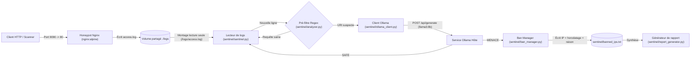
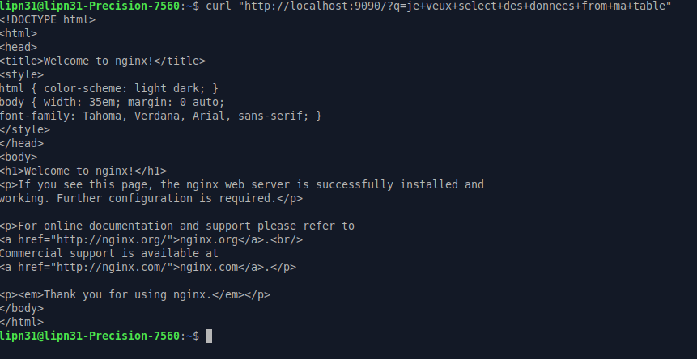

<div align="right">
  <a href="./README.md"></a>
  <a href="./README.fr.md"></a>
</div>

# Sentinel

Système de détection d'intrusions (IDS) conteneurisé associant un honeypot Nginx et un analyseur Python à deux niveaux (pré-filtrage regex et qualification par LLM local `llama3:8b` via Ollama).

## Contexte & Problème

Un filtrage purement par signatures génère des faux positifs sur du trafic web courant, tandis qu'envoyer chaque ligne de log vers un LLM dégrade fortement la latence et les ressources. Faire appel à une API cloud sur des logs bruts pose également des contraintes de confidentialité.

Sentinel combine les deux approches en local : un moteur regex élimine les requêtes anodines en quelques microsecondes et ne transmet que les requêtes suspectes à Ollama sur l'hôte afin de confirmer la menace et journaliser l'IP à bannir.

## Architecture Technique





## Choix d'Ingénierie, Sécurité & Performance

- **Pipeline en deux étapes (`sentinel/analyzer.py`, `sentinel/ollama_client.py`)** : vérifie plus de 30 motifs (XSS, injections SQL, traversée `../`, `/etc/passwd`, `.env`, `.git`, `wp-admin`, exécution système) après décodage URL avant d'interroger `llama3:8b`. Le trafic légitime ne sollicite jamais le modèle.
- **Isolation par volumes (`docker-compose.yml`)** : Nginx et Sentinel tournent sur un réseau bridge dédié (`sentinel_net`), avec montage `./logs` en lecture seule (`:ro`) côté IDS pour empêcher toute altération des journaux.
- **Registre de bannissement dédupliqué (`sentinel/ban_manager.py`)** : charge les IP déjà bannies en mémoire au démarrage et enregistre les nouvelles entrées (`IP | timestamp | raison`) dans `banned_ips.txt` afin d'éviter des appels répétés à l'IA pour une même IP.
- **Inférence 100 % locale** : communication directe avec l'hôte via `host.docker.internal:11434` (timeout 30 s) sans sortie de données vers un service externe.

## Démarrage Rapide

### Prérequis

- Docker et Docker Compose
- [Ollama](https://ollama.com/) installé sur la machine hôte avec `llama3:8b` et accessible depuis les conteneurs (`OLLAMA_HOST=0.0.0.0` sous Linux)

### Lancement

```bash
git clone https://github.com/Git-MohamedB/Sentinel.git
cd Sentinel

# Télécharger le modèle local
ollama pull llama3:8b

# Démarrer le honeypot Nginx (port 9090) et Sentinel
docker compose up --build
```

### Simuler des requêtes suspectes et générer le rapport

```bash
# Générer du trafic normal puis malveillant sur le honeypot
curl "http://localhost:9090/"
curl "http://localhost:9090/?q=' OR 1=1 --"
curl "http://localhost:9090/.env"

# Générer le rapport de synthèse à partir de banned_ips.txt
python3 sentinel/report_generator.py
```

### Lancer les tests unitaires

```bash
python3 sentinel/test_analyzer.py
```

## Pistes d'Amélioration

- Appliquer un blocage réseau effectif en injectant les IP bannies dans `nftables`/`iptables` ou dans un fichier `deny` Nginx rechargé dynamiquement.
- Exécuter le conteneur Python en utilisateur non-root et basculer Nginx sur des logs JSON structurés pour simplifier le parsing.
- Ajouter une rotation des logs et des tests d'intégration CI avec mock de l'API Ollama.
