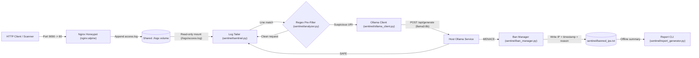
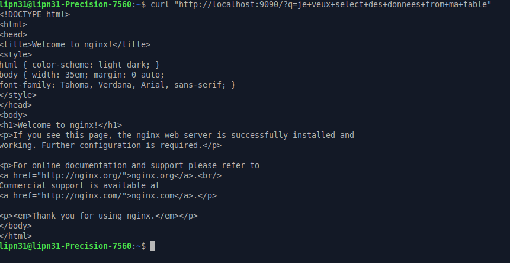

<div align="right">
  <a href="./README.md"></a>
  <a href="./README.fr.md"></a>
</div>

# Sentinel

Containerized intrusion detection system (IDS) pairing an Nginx honeypot with a Python log analyzer backed by regex pre-filtering and local LLM classification (`llama3:8b` via Ollama).

## Context & Problem

Signature-only log scanners generate false positives on noisy web traffic, whereas sending every HTTP access line to an LLM is slow and wasteful. Running an external cloud API on raw server logs also creates data privacy and latency issues.

Sentinel solves this with a two-stage local pipeline: deterministic regex heuristics filter normal traffic in microseconds, and only suspicious requests are escalated to a local Ollama instance on the host to decide whether to record the source IP for banning.

## Technical Architecture





## Engineering Choices, Security & Performance

- **Two-stage filtering (`sentinel/analyzer.py`, `sentinel/ollama_client.py`)**: Checks over 30 regex rules (XSS tags, SQL injection keywords, path traversal `../`, `/etc/passwd`, `.env`, `.git`, `wp-admin`, command execution probes) on URL-decoded paths before calling Ollama. Normal requests never touch the model.
- **Data-volume isolation (`docker-compose.yml`)**: Runs the Nginx decoy and Python IDS on an isolated bridge network (`sentinel_net`). The IDS mounts `./logs` read-only (`:ro`) so it cannot alter web server logs.
- **Persistent IP ban registry (`sentinel/ban_manager.py`)**: Caches banned IPs in memory on startup and appends deduplicated records (`IP | timestamp | reason`) to `banned_ips.txt` to avoid re-analyzing already flagged sources.
- **Local inference via host gateway**: Connects cleanly from inside Docker to the host Ollama daemon (`http://host.docker.internal:11434`) with a 30 s timeout and zero external telemetry.

## Quick Start

### Prerequisites

- Docker and Docker Compose
- [Ollama](https://ollama.com/) installed on the host with `llama3:8b` pulled and listening for container connections (`OLLAMA_HOST=0.0.0.0` on Linux hosts)

### Setup & Run

```bash
git clone https://github.com/Git-MohamedB/Sentinel.git
cd Sentinel

# Pull the local classification model
ollama pull llama3:8b

# Start Nginx honeypot (port 9090) and Sentinel IDS
docker compose up --build
```

### Simulate Suspicious Requests & Generate Report

```bash
# Trigger benign and suspicious requests against the honeypot
curl "http://localhost:9090/"
curl "http://localhost:9090/?q=' OR 1=1 --"
curl "http://localhost:9090/.env"

# Generate summary report from banned_ips.txt
python3 sentinel/report_generator.py
```

### Run Unit Tests

```bash
python3 sentinel/test_analyzer.py
```

## Future Improvements

- Enforce actual network blocking by pushing banned IPs to an `iptables` / `nftables` set or an Nginx `deny` include file with reload hooks (currently bans are logged to `banned_ips.txt`).
- Run the Sentinel Python container as a non-root user and parse structured JSON Nginx logs instead of plain Common Log Format strings.
- Add log rotation (`logrotate`) and automated integration tests mocking the Ollama HTTP endpoint in CI.
